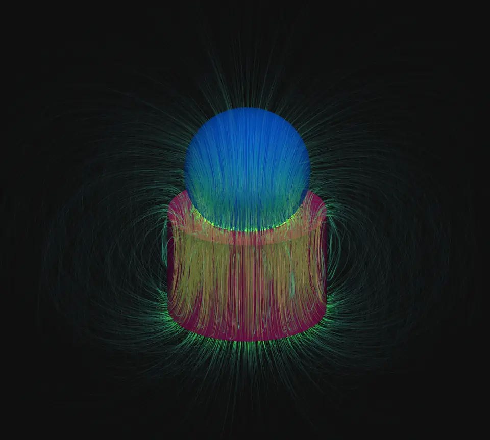
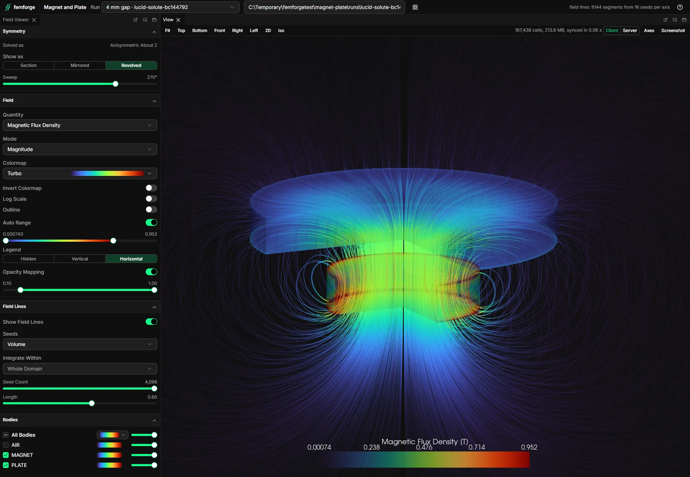
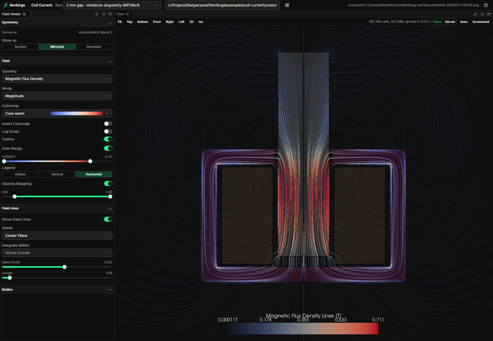
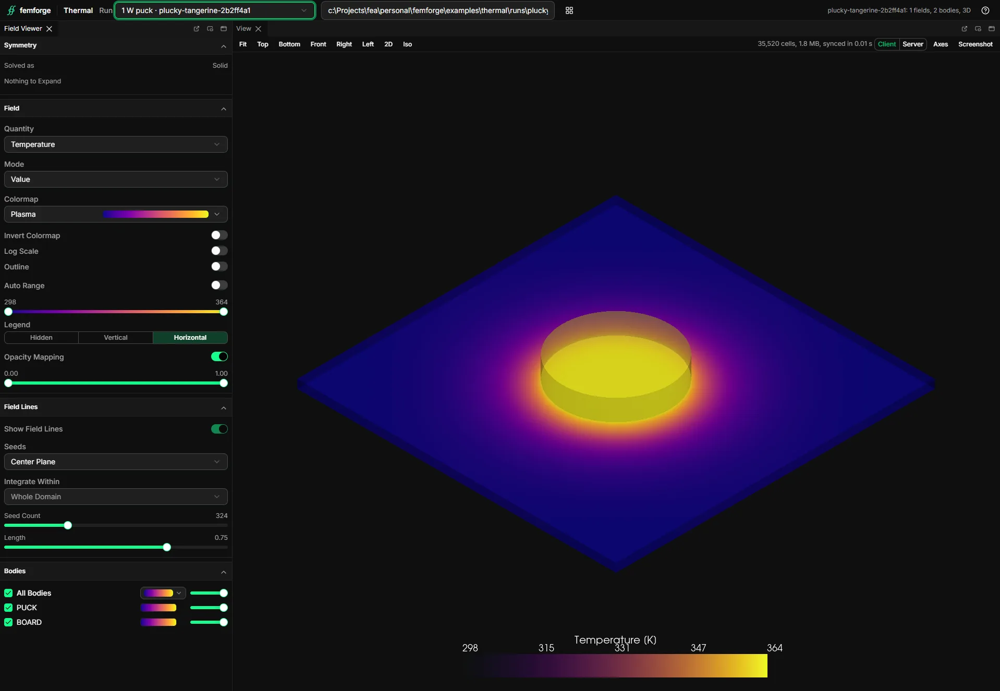

# femforge

femforge is finite-element analysis as a typed Python API.

You describe a simulation once, as one [SimulationConfig][femforge.config.SimulationConfig]: the geometry, the mesh, the materials and conditions of each region, and the physics to solve. Every setting is a typed Pydantic field with a docstring, and every physical quantity carries its unit, so your editor completes the config and validation rejects a mistake before anything is meshed or solved.

The geometry is a STEP file whose bodies are named with their tags, exported from any CAD or scripted in build123d with femforge's helpers.

A [Driver][femforge.run.Driver] meshes the config, solves it and returns a [Result][femforge.run.Result] whose quantities carry their units. Every run lands in a bundle named after the content hash of its inputs, so an identical config reuses the finished run instead of solving again.

The workbench shows the fields and the runs in a browser, and everything it shows is also scriptable. Geometry, meshing and solving run behind interfaces, and [Status](overview/status.md) lists what each one supports today.

femforge is pre-alpha. The API will change between 0.x releases, and the [changelog](changelog.md) records each change.

## See it

Four workbenches, each a script you can run. [Examples](examples/index.md) describes them.

-   

    **[Magnet and plate](overview/quickstart.md)**: a disc magnet pulls on a steel plate at four air gaps. The quickstart.

-   

    **[Bearing seat](examples/bearing-seat.md)**: a magnet holds a steel ball, with and without a shell, in 2D and 3D.

-   

    **[Coil current](examples/coil-current.md)**: a coil in a pot frame pulls a steel plunger across two gaps.

-   

    **[Thermal](examples/thermal.md)**: a puck dissipates 1 W on a board that still air cools.

## How it fits together

1. [Geometry and tags](user-guide/geometry.md): name each body with its material and name tags, in your CAD's STEP export or in a build123d script.
2. [Materials](user-guide/materials.md) and [conditions and physics](user-guide/conditions.md): say what each region is made of, what drives it and which physics to solve.
3. [Mesh](user-guide/mesh.md) and [frames](user-guide/frames/index.md): set the element sizes and choose how the model maps onto the solve.
4. [Driver and runs](user-guide/driver.md): mesh, write the solver input, solve and record the run bundle.
5. [Results](user-guide/results.md): read forces, torques, peak fields and the solved field mesh.
6. [Artifacts and retention](user-guide/artifacts.md) and [telemetry](user-guide/telemetry.md): reuse meshes and runs across processes, trim old bundles and query logs and sweeps.
7. [Workbench](user-guide/workbench.md): browse runs and view fields in a browser.

## Where to start

- [Install](overview/install.md) femforge and an Elmer solver.
- Run a first simulation with the [Quickstart](overview/quickstart.md).
- Run one of the [examples](examples/index.md), each a workbench over a small model.
- Read [Concepts](overview/concepts.md) for the pipeline on one page.
- Check [Status](overview/status.md) for what works today and which tasks are open.
- Work through the [User guide](user-guide/index.md), one task per page.
- Look up a class or function in the [API reference](reference/index.md).
- Set up a development checkout with [Contributing](contributing/index.md).
