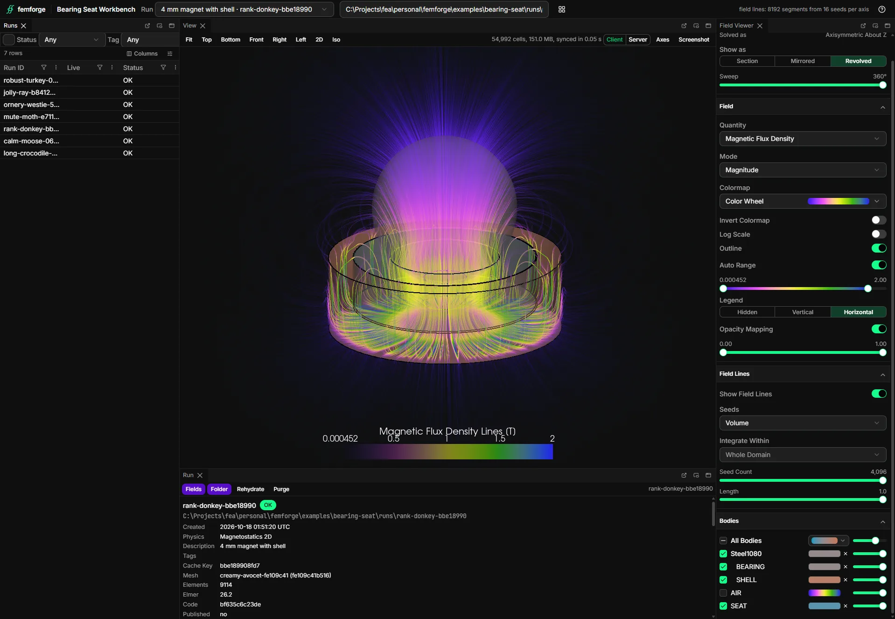

# Workbench

The workbench is a browser app for looking at runs: a dock of panels that shows solved fields in 3D and 2D, browses the run and artifact indexes, and follows runs and sweeps while they solve. It runs as a local [trame](https://kitware.github.io/trame/) server that you start from a script or from the `femforge-workbench` command, and it reads the same telemetry root and run bundles as the rest of femforge. You can also build your own dock from the same panels and list it beside the built-in ones.



## Install

The workbench is a separate package, `femforge-workbench`, that the `workbench` extra installs:

```console
pip install "femforge[workbench]"
```

`ff.workbench` raises an `ImportError` that names this command when the extra is missing. The package has extras of its own, listed on the [install page](../overview/install.md#install-the-package), among them `app` for the `--webview` window and `pty` for an interactive terminal on Windows.

## Open the field viewer from a script

```python
import femforge as ff

display = ff.DisplaySpec(
    field="magnetic flux density",
    mode=ff.DisplayMode.MAGNITUDE,
    colormap="plasma",
    hidden_bodies=("air",),
    body_styles=(ff.BodyStyle(body="mover", paint=ff.BodyPaint.SOLID, color="#c0c0c0", opacity=0.5),),
    streamlines=ff.FieldLineOptions(seed_placement=ff.SeedPlacement.CENTER_PLANE, line_count=16),
)

viewer = ff.workbench.field_viewer(display=display, telemetry="telemetry")
ff.workbench.show(viewer, title="Field viewer")
```

[field_viewer][femforge.workbench.field_viewer] builds the viewer dock. Its run picker lists the indexed runs of the telemetry root, `FEMFORGE_TELEMETRY` when you pass none. Pass `run=` a [Result][femforge.run.Result], a [Run][femforge.run.Run], a run id or a bundle directory to open that run once the server starts. Without one, the viewer opens the newest indexed run as soon as one lands. The [DisplaySpec][femforge.viz.DisplaySpec] sets where the controls start; [Results](results.md#display-state) covers it.

[show][femforge.workbench.show] serves a workbench and returns when its window closes:

| `show(workbench)` | Opens |
|---|---|
| a dock `Split` | that dock, as built |
| a module-level function that returns a `Split` or a `Renderable` | its result, rebuilt on every save of a `.py` file under its source roots |
| a `WorkbenchSpec` | that catalogue card, as the command opens it by name |
| nothing | the launcher |

| `window=` | Opens in |
|---|---|
| `Window.APP`, the default | a Chrome or Edge app window; closing it stops the server |
| `Window.BROWSER` | a tab in the default browser |
| `Window.WEBVIEW` | pywebview, from the `app` extra |

`show` also takes `port`, `telemetry`, `persist` and `watch`, which match the command's flags below.

## The femforge-workbench command

```console
femforge-workbench                                # the launcher
femforge-workbench field-viewer --telemetry telemetry
femforge-workbench -m lab.workbenches:gap_study --app
```

| Argument | Does |
|---|---|
| `name` | Open the catalogue card with this name, such as `demo` or `field-viewer`. Without a name or `-m`, open the launcher. |
| `-m pkg.module:attr` | Open the module attribute, a function that returns a dock `Split` or a `Renderable`. |
| `-m pkg.module` | Open the module's `main()`, which returns a `Renderable`. |
| `--app` | Open a Chrome or Edge app window; closing it stops the server. |
| `--webview` | Open in pywebview, from the `app` extra. |
| `--dev` | Run the server as a child that restarts after every save to the shell's own modules; the page reloads itself. |
| `--port N` | Serve on port `N`, 8080 by default. |
| `--watch DIR` | Also rebuild the open workbench when a `.py` file under `DIR` is saved. Repeatable. |
| `--telemetry DIR` | The telemetry root the panels read. It also sets `FEMFORGE_TELEMETRY` for the process, so a card opened later reads the same root. |
| `--persist DIR` | Where layouts and choices are saved, the per-user config directory by default. |

Without `--app` or `--webview`, the command opens a browser tab. An unknown name, or the `browsers` or `monitors` card without a telemetry root, exits with code 2 and a message. [CLI](cli.md) lists the command beside `femforge`.

## The built-in cards

| Card | Opens |
|---|---|
| `launcher` | Every catalogue card: open and close docks, open previews, run scripts and browse what they produced. |
| `demo` | A sphere, a line figure and a grouped table, to try the shell without data. |
| `browsers` | The run browser over the run detail, beside the artifact browser over the artifact detail. |
| `field-viewer` | A solved run's fields: the view, the symmetry expansion, colormaps, bodies and field lines. |
| `monitors` | A run's heartbeat, stages, convergence and logs; a sweep's progress and failures; the log browser; a terminal. |

The `browsers` and `monitors` cards read the telemetry root; the [Telemetry](telemetry.md) page covers what it holds. The artifact panels read the store at `FEMFORGE_ARTIFACTS` when it is set, else the store the index rows name.

## The field viewer

The field viewer puts its controls beside one view, which draws every run, flat or solid. The app bar holds the run picker, which lists the 200 newest indexed runs that have fields, are still solving or failed, newest first, and shows the open run's bundle path beside it. Each run reads as its description, with its run id muted beside it. A run that is still solving reads Solving and opens once its solve ends; one whose solve failed reads Failed. The list follows the run index every second and holds still while its dropdown is open, so a run that lands never moves the row under the pointer and never replaces the open run. With no run given, the viewer opens the newest run with fields as soon as one lands, else the newest one still solving, else the newest failed one. The camera stays put when the next run frames alike.

The first time a run opens, a short tour points out the run picker, each section of the controls and the view's toolbar. Skip or Esc ends it, and it stays closed on later starts. The help button at the right of the app bar replays it.

The controls come in four sections:

| Section | Controls |
|---|---|
| Symmetry | Solved As, Show As, Sweep |
| Field | Quantity, Mode, Colormap, Invert Colormap, Log Scale, Outline, Auto Range with the color range slider, Legend, Opacity Mapping |
| Field Lines | Show Field Lines, Seeds, Integrate Within, the seed count, Length |
| Bodies | An All Bodies row with the body colormap and the overall opacity, then one row per body and per material that owns several bodies, each with a visibility checkbox, a color and an opacity |

**Symmetry expands a run solved on a section.** Solved As names the solve frame. For an axisymmetric run, Show As shows the r–z half-plane as solved, mirrors it into the full plane, or revolves it around the axis into a solid in the frame the model was authored in. Revolve is the default, at a full Sweep of 360°; a smaller sweep cuts the solid open so the cut faces show the field inside the bodies. Only the surfaces are revolved, so a section costs about as much to draw revolved as flat. The field lines of a revolved run are seeded as in a solid run, on the center plane, the gap line or through the volume of the swept solid, integrated in the section and swept back to their seeds. A run solved in 3D or on a planar Cartesian 2D section has nothing to expand. [DisplaySpec][femforge.viz.DisplaySpec] holds the choice as `expansion` and `sweep`.

**The legend starts hidden.** The range slider wears the colormap between its thumbs, so the controls read as the legend. Set Legend to Vertical or Horizontal to draw a color bar in the view, titled with the field's unit, before a screenshot. Field lines share that bar while they map like the field, and get a bar of their own only when their colormap or range differs. Moving a thumb of the range slider pins the range and turns Auto Range off.

The Quantity picker lists every scalar, vector and principal-value array of the run. A stress or strain tensor is left out; read it with [Run.mesh()][femforge.run.Run.mesh]. The Mode picker offers what the quantity supports:

| [DisplayMode][femforge.viz.DisplayMode] | Colors by | Offered for |
|---|---|---|
| `MAGNITUDE` | the vector magnitude | vectors, the default |
| `X`, `Y`, `Z` | one component | vectors |
| `POLAR_XY` | the in-plane direction as hue, brightened by the in-plane magnitude | vectors |
| `VALUE` | the value | scalars, the default |
| `ABSVALUE` | the absolute value | scalars |
| `MAX_PRINCIPAL` | the largest principal value | principal stresses and strains, the default |
| `MID_PRINCIPAL`, `MIN_PRINCIPAL` | the middle or the smallest principal value | principal stresses and strains |

Each body's color comes from one of three sources, its [BodyPaint][femforge.viz.BodyPaint]:

| Paint | Color | In the body row |
|---|---|---|
| `FIELD` | the field colormap, by the displayed value | a swatch of the field colormap; click it for the body colormap |
| `COLORMAP` | one color of the body colormap, spread evenly over every body that takes it | a color chip; pick a color to fix it |
| `SOLID` | the body's own color | a color chip; the cross returns the body to the field colormap |

**The automatic color range spans every body.** With Auto range on, the range is the union of each body's own range, over every body whether it is shown, hidden or painted another way, so hiding a body never rescales the rest. Each body is clamped to its 2nd to 98th percentile, so a small body keeps its range beside a large one. Log scale keeps only the positive values and starts at their 1st percentile. Turn Auto range off to pin the range with the slider.

Field lines follow the shown vector field. While a scalar or a principal value is shown, they follow the magnetic flux density, else the first vector field, such as the displacement of an elasticity run. The switch stays off for a run without a vector field. They start on, from 18 × 18 seeds on the center plane. Seeds sit on a grid in the domain's bounding box: a volume, the center plane or a line along X through the center. A run shown flat moves volume seeds to the center plane. Length is the fraction of the domain diagonal a line may run, and each line ends at its first sharp reversal. Integrate Within limits the lines to one body.

## Runs and figures

| Panel | Shows |
|---|---|
| [RunBrowserPanel][femforge.workbench.RunBrowserPanel] | The run index as a table, refreshed every 5 s, with text, status, tag and physics filters and the runs claimed right now marked. A row click selects the run. |
| [RunDetailPanel][femforge.workbench.RunDetailPanel] | The selected run: its manifest summary, stage timeline, results, artifact inputs, files and retention history, re-read every second while it solves. Fields opens the run in the field viewer, Folder opens its directory, Rehydrate fetches its store inputs back and Purge opens a dialog that removes bundle files by a retention plan. |
| [FigurePanel][femforge.workbench.FigurePanel] | One plotly figure; `update()` swaps it, a figure with a `uirevision` keeps its zoom and selections, and `bind()` routes plotly events to a handler. |
| [TablePanel][femforge.workbench.TablePanel] | A polars frame that the browser sorts, filters, groups and hides columns of, with its layout saved per panel. |

## The dock

A dock is a tree of three nodes:

| Node | Holds |
|---|---|
| [Panel][femforge.workbench.Panel] | One tab: a title, a builder that makes the component once the shell exists, a `weight` and an optional `id`. |
| [Tabs][femforge.workbench.Tabs] | Panels sharing one tab group, the first one shown. |
| [Split][femforge.workbench.Split] | Panels, tab groups and splits along one axis, shared by weight. The root is horizontal and the axis alternates with depth. |

A panel's id is its `id`, else its title in lower case with dashes. The builder receives the shell, the id and the title.

The workbench saves its layout and its open cards when they change, and restores the layout on the next start when it names exactly the panels the dock defines; a changed dock starts from its authored layout. Popped-out and floating groups come back docked. The reset button in the app bar rebuilds the authored layout. Each table saves its column layout and each 3D view its render mode.

The documents live in the per-user config directory, such as `%LOCALAPPDATA%\femforge-workbench` on Windows or `~/.config/femforge-workbench` on Linux, as `<user>/<workbench>/<key>.json`. Pass `--persist DIR` to keep them elsewhere.

## Write your own workbench

A workbench is a module-level function that returns a `Split`. Register it as a card through the `femforge.workbenches` entry point group:

```python
import femforge as ff
import plotly.graph_objects as go
import polars as pl
from femforge_workbench.registry import WorkbenchSpec, panel


def force_curve(app: ff.workbench.Workbench, id: str, title: str) -> ff.workbench.FigurePanel:
    """The force against the gap."""
    figure = go.Figure(go.Scatter(x=[1.0, 2.0, 3.0], y=[8.7, 6.1, 4.4], name="force"))
    return ff.workbench.FigurePanel(app, id, title, figure)


def points(app: ff.workbench.Workbench, id: str, title: str) -> ff.workbench.TablePanel:
    """The solved points."""
    frame = pl.DataFrame({"gap": [1.0, 2.0, 3.0], "force": [8.7, 6.1, 4.4]})
    return ff.workbench.TablePanel(app, id, title, frame, filterable=True)


def gap_study() -> ff.workbench.Split:
    """The force curve beside its points."""
    return ff.workbench.Split([ff.workbench.Panel("Force", force_curve, weight=2), ff.workbench.Panel("Points", points)])


WORKBENCHES: list[WorkbenchSpec] = [
    panel("gap-study", "Gap Study", target=gap_study, description="Force against air gap.", group="Lab"),
]


if __name__ == "__main__":
    ff.workbench.show(gap_study)
```

```toml
[project.entry-points."femforge.workbenches"]
lab = "lab.workbenches:WORKBENCHES"
```

An entry point provides one [WorkbenchSpec][femforge_workbench.registry.WorkbenchSpec] or a sequence of them. Three functions in [femforge_workbench.registry][] declare one:

| Function | Card | Opens |
|---|---|---|
| `panel` | dock | the dock its target returns |
| `renderable` | viewer | the `Renderable` its target returns, in one 3D panel |
| `script` | script | its module, run with `python -m` in a subprocess; the launcher shows the files it lists in `outputs` |

A target is the function itself or its `pkg.module:attr` name, and its module is imported only when the card opens, so listing the catalogue imports nothing heavy. Two different specs under one name raise an error. A dock or viewer card rebuilds in place when you save a `.py` file under its source roots or a `--watch` directory, keeping the layout; a builder that raises leaves the old panels and names the error in the status line.

## Limits

- **One VTK.wasm mirror per page.** The newest 3D panel mirrors its scene in the browser; older ones stream rendered frames from the server and say so in their status line.
- A scene whose geometry exceeds 64 MB streams from the server instead of mirroring.
- `--app` and `Window.APP` look for Chrome and Edge at their default Windows install paths. Without either, the workbench opens a browser tab, and closing it leaves the server running.
- The terminal panel is interactive on Windows with the `pty` extra. Elsewhere it shows the live log stream, read-only.
- A `Split` passed to `show` is served as built. Pass the function that builds it to rebuild on save.
- The `browsers` and `monitors` cards need a telemetry root.
